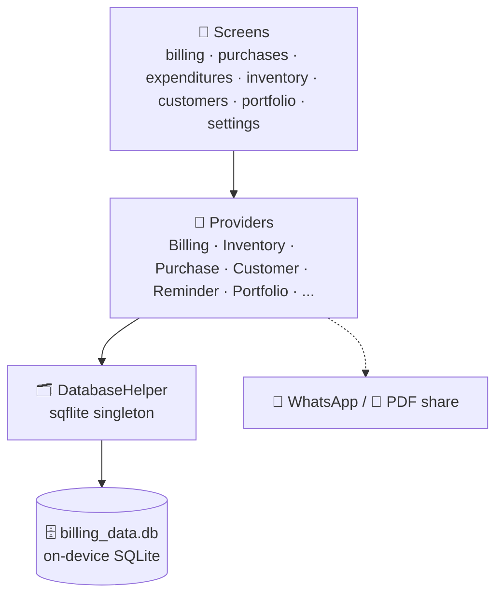

<div align="center">

# 📱 Billing System App — Garage Billing for Android

**A Flutter Android app for running a car garage's billing from your phone: bills, purchases, expenses, inventory, customers, service reminders and reports, all stored offline in SQLite.**


-003B57?logo=sqlite&logoColor=white)


[Overview](#-overview) • [Two Versions](#-two-versions-in-this-repo) • [Features](#-features) • [Tech Stack](#-tech-stack) • [Getting Started](#-getting-started) • [Import Desktop Data](#-importing-your-desktop-data) • [Database](#-database)

</div>

---

## 📋 Overview

This is the **Android companion of my Python garage billing software** ([Billing_system](https://github.com/IshanPatel1912/Billing_system)). It does what the desktop app does, but in your pocket: create a bill at the car, share it on WhatsApp, check today's profit, and see which customers are due for service.

All data lives in a local SQLite database on the phone, so the app works **without internet**.

---

## 📂 Two Versions in This Repo

| Folder | Use it when | What happens on first launch |
|---|---|---|
| [`app/`](./app) | You are **starting fresh** | Creates an empty database with all tables |
| [`app_with_data/`](./app_with_data) | You want to **bring your existing desktop data** | Copies the bundled `assets/billing_data.db` (exported from the Python app) into the phone, upgrades it to the app's format and resets the admin login |

Both folders contain the same screens and features. Only the database start-up differs.

---

## ✨ Features

### 🧾 Billing
- Create bills with customer details, items, quantity, rate and discount
- Mark a bill **paid** or unpaid
- **Send the bill on WhatsApp** straight from the app
- **PDF invoices** you can print or share

### 🔍 Find Invoice
- Search old bills, edit them, and **restore** deleted ones

### 🛒 Purchases & 💸 Expenses
- Record purchases and daily expenses
- Browse **purchase history**

### 📦 Inventory
- Stock items with quantity, cost price and MRP

### 👥 Customer Directory
- Customer profiles with the **vehicles linked** to each customer

### 🔔 Service Reminders
- Due dates for the next service, with a **badge showing the number of pending reminders** on the home screen

### 📊 Dashboard & Portfolio
- **Dashboard** with daily stats and itemized views
- **Portfolio analytics** — profit, loss and custom date-range reports

### 🔐 Security & Settings
- Username and password login
- **Biometric login** (fingerprint / face) you can switch on in settings
- Edit your **business profile** and upload a **logo**
- Users are stored in the app database

### 🧭 Navigation

| Bottom bar | More menu |
|---|---|
| Billing · Purchases · Expenses · Inventory · More | Find Invoice · Dashboard · Portfolio Analytics · Customer Directory · Settings & Security |

---

## 🛠️ Tech Stack

| Layer | Technology |
|---|---|
| **Framework** | Flutter (Dart SDK ^3.10) |
| **State management** | Provider (`ChangeNotifier`, one provider per feature) |
| **Database** | `sqflite` (local SQLite) |
| **PDF** | `pdf` and `printing` |
| **Sharing** | `share_plus`, `url_launcher` (WhatsApp) |
| **Security** | `local_auth` (biometrics), `crypto` (password hashing) |
| **Storage** | `shared_preferences`, `path_provider`, `image_picker` |

---

## 🏗️ Architecture



### Project structure

```
BillingSystem_App/
├── app/                              # Fresh-start version
│   ├── lib/
│   │   ├── main.dart                 # App entry, providers, bottom navigation
│   │   ├── core/database_helper.dart # Tables + migrations
│   │   ├── providers/                # 11 providers (one per feature)
│   │   └── screens/                  # billing, bills, purchases, expenditures,
│   │                                 # inventory, customers, portfolio,
│   │                                 # dashboard, settings, more, login, reminders
│   ├── web/
│   └── pubspec.yaml
│
└── app_with_data/                    # Same app + bundled desktop database
    ├── assets/billing_data.db        # Data exported from the Python app
    ├── lib/core/database_helper.dart # Copies and upgrades the bundled DB
    └── ...
```

---

## 🚀 Getting Started

### Prerequisites

- [Flutter SDK](https://docs.flutter.dev/get-started/install) (Dart 3.10 or later)
- Android Studio with an emulator, or an Android phone with USB debugging

### Run the fresh-start app

```bash
git clone https://github.com/IshanPatel1912/BillingSystem_App.git
cd BillingSystem_App/app
flutter pub get
flutter run
```

### Run the version with imported data

```bash
cd BillingSystem_App/app_with_data
flutter pub get
flutter run
```

### Build an APK

```bash
flutter build apk --release
```

The APK is created at `build/app/outputs/flutter-apk/app-release.apk`.

### Default login

A new database starts with the user **`admin`**. Change the password in **More → Settings & Security** after your first login.

---

## 🔄 Importing Your Desktop Data

To move your data from the **Python garage app** onto the phone:

1. **Find the desktop database.** On Windows it is `billing_data.db`, in the app's hidden folder in your user profile (for example `C:\Users\<you>\.BillingSystem\`).
2. **Replace** `app_with_data/assets/billing_data.db` with your file (keep the same name).
3. Run the app from `app_with_data/`.
4. On the **first launch** the app copies the database to the phone and then:
   - adds any missing `is_deleted` columns so older data works with the app,
   - sets the `admin` password to the app's default, because the desktop app hashes passwords differently (bcrypt) from the Android app.

> ⚠️ The copy only happens on the **first launch**. To import a new file, uninstall the app (or clear its storage) and run it again.

---

## 🗃️ Database

Tables created by the app (same layout as the desktop version):

| Table | Purpose |
|---|---|
| `sales`, `sale_items` | Bills and their items |
| `purchases`, `purchase_items` | Purchases and their items |
| `expenditures` | Expenses |
| `inventory` | Stock |
| `customers`, `customer_cars` | Customers and their vehicles |
| `service_reminders` | Next-service reminders |
| `business_details` | Business profile and logo |
| `users` | Login accounts |

---

## 🗺️ Roadmap

- [ ] In-app import of a `.db` file (no rebuild needed)
- [ ] Export / backup the database to Google Drive
- [ ] Cloud sync with the desktop app
- [ ] iOS build

---

## 👤 Author

**Ishan Patel** — Undergraduate student, Pandit Deendayal Energy University (PDEU)

[](https://github.com/IshanPatel1912)

Desktop version: [Billing_system](https://github.com/IshanPatel1912/Billing_system)

---

<div align="center">

**Built with ❤️ and Flutter**

[🔝 Back to top](#-billing-system-app--garage-billing-for-android)

</div>
